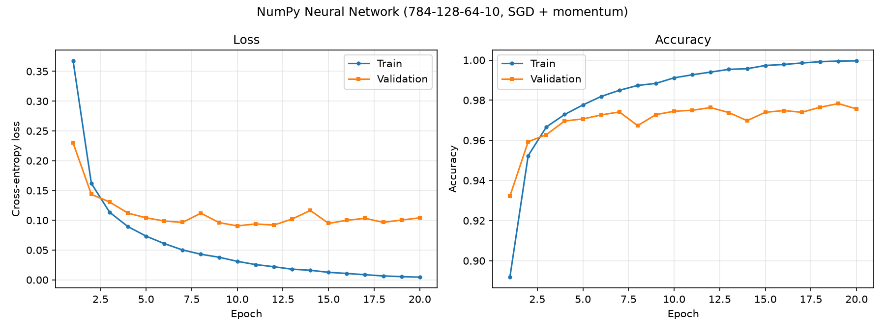
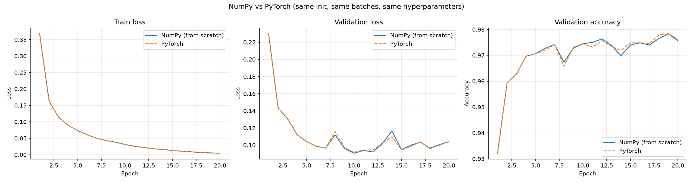
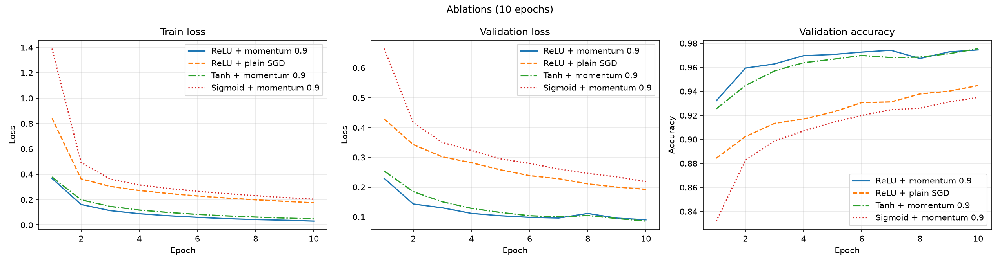

# Neural Network from Scratch (NumPy)

A fully connected feedforward neural network implemented **using only NumPy**: forward propagation, backpropagation, multiple activation functions, mini-batch gradient descent and SGD with momentum. It is trained on MNIST, its gradients are verified numerically, and its results are compared against an equivalent PyTorch model.

> The `nn/` package imports **only NumPy**. Matplotlib, PyTorch and torchvision are used solely for plotting, the comparison model and dataset download.

## Project Structure

```
neural-network-from-scratch/
├── nn/
│   ├── activations.py   # ReLU, Sigmoid, Tanh, Softmax (forward + backward)
│   ├── layers.py        # Dense layer, He / Xavier initialization
│   ├── losses.py        # Softmax + cross-entropy
│   ├── optimizers.py    # SGD with momentum
│   ├── network.py       # NeuralNetwork: forward, backward, fit, evaluate, predict
│   └── utils.py         # one-hot encoding, mini-batch index generator
├── config.py            # hyperparameters shared by NumPy and PyTorch runs
├── data.py              # MNIST loading, train/validation split
├── download_data.py     # downloads MNIST -> data/mnist.npz
├── gradient_check.py    # numerical gradient verification
├── train_numpy.py       # trains the NumPy network
├── train_pytorch.py     # same model in PyTorch (comparison)
├── compare.py           # overlay plots + comparison table
├── experiments.py       # ablations: momentum vs SGD, ReLU vs Tanh vs Sigmoid
├── plotting.py          # matplotlib helpers
└── results/             # curves, histories, tables
```

## Setup and Usage

```bash
python -m venv venv
venv\Scripts\activate            # Windows   (Linux/Mac: source venv/bin/activate)
pip install -r requirements.txt

python download_data.py          # once: creates data/mnist.npz
python gradient_check.py         # 1. verify backprop first
python train_numpy.py            # 2. train the NumPy model (saves shared initial weights)
python train_pytorch.py          # 3. train the PyTorch equivalent
python compare.py                # 4. comparison table + plots
python experiments.py            # optional ablations
```

Run `train_numpy.py` before `train_pytorch.py`: the PyTorch model starts from the NumPy model's initial weights.

## What Each Part Does and Why

### Data (`data.py`)
MNIST images (28x28) are flattened to 784 features and scaled to [0, 1] so inputs have a consistent range, which keeps gradients well behaved. The 60,000 training images are split 90/10 into train (54,000) and validation (6,000); the 10,000 test images are used only once at the end. Labels are one-hot encoded for the cross-entropy loss.

### Dense layer (`nn/layers.py`)
Computes `Z = X·W + b`. During the forward pass the input `X` is cached; the backward pass uses it:

```
dW = Xᵀ · dZ        db = Σ dZ (over batch)        dX = dZ · Wᵀ
```

**Initialization.** Weights are drawn from a normal distribution with variance `2/n_in` (**He**, for ReLU) or `2/(n_in+n_out)` (**Xavier/Glorot**, for Tanh/Sigmoid/output layer). This keeps the variance of activations and gradients roughly constant across layers; a naive initialization causes vanishing or exploding signals. Biases start at zero.

### Activation functions (`nn/activations.py`)
| Activation | Forward | Derivative |
|---|---|---|
| ReLU | `max(0, z)` | `1 if z > 0 else 0` |
| Sigmoid | `1 / (1 + e^-z)` | `a(1 - a)` |
| Tanh | `tanh(z)` | `1 - a²` |
| Softmax | `e^zᵢ / Σ e^zⱼ` | Jacobian-vector product `s ⊙ (g - Σ g·s)` |

ReLU is the default hidden activation (cheap, no saturation for positive inputs). Softmax turns the final logits into class probabilities. Sigmoid and Tanh are included for comparison. Sigmoid and Softmax use numerically stable formulations.

### Loss (`nn/losses.py`)
`L = -(1/N) Σ Σ yₖ log(softmax(z)ₖ)`. Softmax and cross-entropy are fused, because the combined gradient w.r.t. the logits is simply

```
dL/dz = (softmax(z) - y) / N
```

and the log-sum-exp trick avoids `log(0)` and `exp` overflow.

### Backpropagation (`nn/network.py`)
The loss gradient is pushed backwards through the layers with the chain rule. Each activation multiplies by its local derivative, each Dense layer computes `dW`, `db` and passes `dX` to the previous layer.

### Mini-batch gradient descent (`NeuralNetwork.fit`)
Each epoch the training set is shuffled and processed in batches of 64: forward → loss → backward → optimizer step. Compared with full-batch descent this gives many more updates per epoch and better generalization noise; compared with single-sample SGD it is much faster thanks to vectorized matrix operations.

### SGD with momentum (`nn/optimizers.py`)
```
v ← β·v − lr·∇L
w ← w + v          (β = 0.9, lr = 0.01)
```
Momentum accumulates an exponentially decaying average of past gradients, damping oscillations across steep directions and accelerating progress along consistent ones. Setting `β = 0` gives plain SGD (used in `experiments.py` for comparison). This update is mathematically equivalent to `torch.optim.SGD(momentum=β)`.

### Gradient checking (`gradient_check.py`)
Backprop bugs are silent: the model still trains, just badly. So every analytic gradient is compared with a centered finite difference:

```
∂L/∂θᵢ ≈ (L(θᵢ + ε) − L(θᵢ − ε)) / 2ε ,   ε = 1e-5
relative error = ‖g_analytic − g_numeric‖ / (‖g_analytic‖ + ‖g_numeric‖)
```

The check runs on a tiny 5-4-4-3 network in float64 for ReLU, Tanh and Sigmoid; a relative error below `1e-7` counts as a pass. Biases are initialised to small random values for this test because a ReLU pre-activation of exactly 0 (the kink) makes finite differences meaningless.

## Results

**Training curves:** `results/numpy_training_curves.png`, `results/pytorch_training_curves.png`



### NumPy vs PyTorch (784-128-64-10, 20 epochs)

Same architecture, same initial weights, same mini-batch order, lr = 0.01, momentum = 0.9, batch size = 64.

| Metric | NumPy | PyTorch | Abs. difference |
|---|---|---|---|
| Final train loss | 0.0045 | 0.0045 | 0.0000 |
| Final val loss | 0.1041 | 0.1040 | 0.0001 |
| Final val accuracy | 0.9757 | 0.9762 | 0.0005 |
| Test loss | 0.0752 | 0.0748 | 0.0004 |
| Test accuracy | 0.9798 | 0.9798 | 0.0000 |
| Training time (s) | 55.6 | 52.1 | 3.5 |

Max |val-loss difference| over all epochs: 6.75e-03.



### Ablations (10 epochs)

| Config | Val acc | Test acc | Test loss |
|---|---|---|---|
| ReLU + momentum 0.9 | 0.9745 | 0.9784 | 0.0716 |
| ReLU + plain SGD | 0.9448 | 0.9494 | 0.1741 |
| Tanh + momentum 0.9 | 0.9755 | 0.9747 | 0.0819 |
| Sigmoid + momentum 0.9 | 0.9350 | 0.9418 | 0.1983 |



## Conclusions

- **Correctness:** The gradient check passes for ReLU, Tanh and Sigmoid, so the hand-written backpropagation is correct.
- **NumPy vs PyTorch:** The from-scratch model reaches the same test accuracy as PyTorch (97.98%). The test loss differs by only 0.0004 and the validation loss never differs by more than 6.75e-03 in any epoch. The small gap comes from floating-point details of the two implementations. NumPy was about 3.5 s slower over 20 epochs (55.6 s vs 52.1 s).
- **Momentum:** With momentum 0.9, ReLU reached 97.84% test accuracy after 10 epochs, versus 94.94% with plain SGD at the same learning rate. Momentum clearly speeds up convergence.
- **Activation functions:** ReLU and Tanh both trained well and reached similar validation accuracy (97.45% and 97.55%). ReLU had the better test accuracy and test loss. Sigmoid was clearly slower (93.50% validation accuracy after 10 epochs) because it saturates and its gradients become small.
- **Overfitting:** Training accuracy reaches about 99.96% while validation accuracy stays around 97.6%, and the validation loss stops improving after roughly epoch 10. Regularization (dropout, weight decay) or early stopping would be a natural next step.

## Requirements

Python 3.9+, NumPy, Matplotlib, PyTorch, torchvision (see `requirements.txt`).
